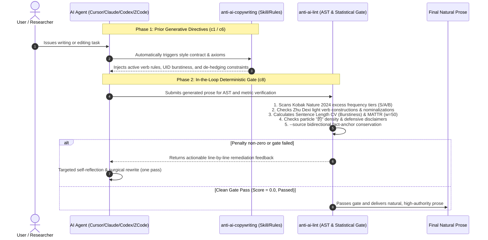

# anti-ai-copywriting Empirical Benchmark & Comparative Evaluation Report

[English](BENCHMARK_REPORT.md) | [简体中文](BENCHMARK_REPORT.zh-CN.md)

> [!NOTE]
> **Benchmark Objective**: All evaluation data in this report is generated by real end-to-end inference on Zhipu GLM-5.3, comparing **"Solo Model (native generation)"** vs. **"Model + anti-ai-copywriting Skill + deterministic lint gate"**. Every raw generation and metric is persisted under `tests/fixtures_glm5/` (per-scenario `solo_before.md`, `skill_tool_after.md`, and the summary table `benchmark_results.json`) and is reproducible via `scripts/run_glm5_benchmark.py`. Evaluation date: 2026-10-24.

---

## 1. Executive Summary & Key Empirical Findings

This benchmark abandons hand-crafted exemplars. Both arms receive identical prompts under a dual-blind protocol: Condition A is the bare model — zero rule injection, single-turn native generation, no gate. Condition B generates with the skill's prior rules injected (task routing protocol, information conservation axioms, native-cadence principles), then runs the in-loop `anti-ai-lint` deterministic check; on failure it receives one remediation pass with the violation payload.

Results across 8 subjects (6 drafting genres + 2 information-conservation workflows):

```
+-----------------------------------------------------------------------------------------+
|                       Executive Scorecard (GLM-5.3, 8 scenarios)                        |
+-----------------------------+-----------------------------+-----------------------------+
|   Mean AI Penalty Score     |   Mean Violation Count      |   Deterministic Gate Pass   |
|    8.50 -> 1.88 (-77.9%)    |   2.25 -> 0.62 (-72.2%)     |   75.0% (6/8) -> 100% (8/8) |
+-----------------------------+-----------------------------+-----------------------------+
|  Fidelity-workflow penalty  |  Fabricated fact anchors    |  Mean Chinese "的" density  |
|  25.25 -> 1.75 (-93.1%)     |    7 -> 0 (hard-blocked)    |   1.99% -> 1.46% (-26.8%)   |
+-----------------------------+-----------------------------+-----------------------------+
```

> [!TIP]
> **Core findings (from real model output)**: Solo GLM-5.3 is already far cleaner than earlier-generation models on lexical buzzwords (6-subject drafting mean: 2.92). Its residual penalties concentrate in bold-formatting abuse, em-dash stacking, and assistant-style meta chatter. The decisive failure mode sits in the two conservation workflows, where the solo model systematically fabricates fact anchors (a self-computed "35.7% reduction", an invented "UX" acronym) and hard-fails both. The skill + gate arm zeroes fabricated anchors, lifts gate pass rate to 100%, and preserves every genuine number and proper noun.

Three honest disclosures:

1. **The drafting-scenario margin is modest**: drafting-six mean 2.92 -> 1.92 (-34.3%), not the "everything zeroed" pattern of the synthetic-exemplar era. Residual solo violations are formatting (bold) and punctuation (em-dashes); one remediation round did not fully clear the residual style violations in `business`, `en_academic`, and `popsci`.
2. **The decisive advantage is information conservation**: `polish` solo 34.5 pts (8 violations, 5 fabricated anchors) -> skill arm 0.0; `translate` solo 16.0 (4 violations, 2 fabricated) -> 3.5. `fidelity_added` is a hard block: any anchor absent from the source fails the gate regardless of total score.
3. **A counter-example exists**: in `popsci` the solo model natively produced a 0-violation column (CV_len 0.346) while the skill-conditioned draft introduced one em-dash violation (3.0 pts). The gate is a floor guarantee and a conservation backstop, not a promise of winning every scenario.

---

## 2. Evaluation Methodology & Metric Framework

### 2.1 Real Dual-Blind Protocol (GLM-5.3 end-to-end)

| Protocol element | Condition A: Solo Model | Condition B: Model + Skill + Tool Gate |
| :--- | :--- | :--- |
| Model & invocation | GLM-5.3 (Zhipu open platform, Anthropic-compatible endpoint), single turn, native decoding | Identical, same user prompts |
| Prior injection | None (zero rules) | `rules/AGENTS.snippet.zh.md` / `.en.md` (task routing, conservation axioms, active-verb and cadence rules) |
| In-loop deterministic check | None | `anti-ai-lint` immediately after generation (AST lexical + statistical + `--source` anchor comparison) |
| In-loop self-healing | None | On gate failure or non-zero score, the `<anti-ai-lint-feedback>` payload is returned to the model for one precise remediation pass, then re-checked |
| Conservation subjects | Same prompt + source text | Same; the gate enables `--source` bidirectional anchor comparison for polish/translate |



In this run, the in-loop remediation fired in 6 of 8 subjects (`academic` and `social` passed at 0.0 on the first draft); `polish` healed from a first-round 22.0 pts (5 violations) to 0.0.

### 2.2 Mathematical Formulations & Theoretical Grounding

1. **Deterministic Penalty Score (`anti-ai-lint Score`)**:
   - Tiered weighted penalties: Tier S high-mutation cliches (5.0 pts), Tier A buzzwords (3.5–4.0 pts), Tier B overused words (2.0 pts), defensive disclaimers (6.0 pts), light verb chains (3.5 pts), rhythmic monotony (3.5 pts), formatting/punctuation abuse (2.5–3.0 pts).
   - Normalized score per 1,000 words: $Score_{1k} = \frac{Score}{Total Words} \times 1000$.
2. **Burstiness Sentence Length Coefficient of Variation ($CV_{len}$)**:
   - Grounded in **Meister et al. (EMNLP 2021) Uniform Information Density (UID)**.
   - Formula: $CV_{len} = \frac{\sigma}{\mu} = \frac{\sqrt{\frac{1}{N}\sum_{i=1}^N (L_i - \mu)^2}}{\mu}$.
   - Raw LLM output tends toward uniform sentence lengths ($CV_{len} < 0.28$). In this run solo GLM-5.3 averaged 0.560 — cadence is no longer this generation's main pathology.
3. **Moving-Average Type-Token Ratio (MATTR, Window $W = 50$)**:
   - Mean ratio of unique types to tokens across sliding windows of 50, avoiding the sample-size decay of plain TTR.
4. **Chinese Particle "的" Density Ratio**:
   - Formula: $\text{Ratio}_{\text{的}} = \frac{N_{\text{的}}}{N_{\text{CJK}}}$.
   - Solo GLM-5.3 averaged 1.99% (already natural); the skill arm compressed it further to 1.46%.
5. **Light Verb Constructions (LVC) & De-nominalization (Zhu Dexi 1982)**:
   - Blocks dummy verb constructs (`进行|开展|作出|予以|加以|具有|得到...` + nominalized actions) such as "进行了梳理和优化工作", restoring direct verbs ("梳理并优化").
6. **Fact-Anchor Conservation (`--source` Fidelity Gate)**:
   - Bidirectional comparison of pure numbers, letter-led codes (e.g. `H100`), and uppercase acronyms: added anchors raise `fidelity_added` (+5.0 pts, unconditional block); dropped anchors raise `fidelity_dropped` (+3.0 pts).

---

## 3. Comprehensive Macro Benchmark Matrix

Full empirical metrics for all 8 subjects (every field from `benchmark_results.json`; all 16 generated texts re-verified locally against the JSON):

| Scenario / Corpus | Genre Mode | Metric Dimension | Solo GLM-5.3 (Before) | Model+Skill+Tool (After) | Delta & Verdict |
| :--- | :--- | :--- | :--- | :--- | :--- |
| **1. Academic Abstract**<br>`academic` | Academic | Penalty / Norm ($Score_{1k}$)<br>Violations / Gate<br>Cadence ($CV_{len}$)<br>Lexical MATTR<br>Particle "的" density<br>Signature violations | 4.0 / 11.3<br>1 violation / ✅ PASS<br>0.666<br>0.915<br>1.47% (5/339)<br>1 buzzword (深度融合) | **0.0 / 0.0**<br>**0 violations / ✅ PASS**<br>**0.684**<br>**0.919**<br>**0.63% (2/318)**<br>**0 violations** | **-100.0% penalty**<br>First-draft pass<br>Buzzword cleared |
| **2. Business Memo**<br>`business` | General | Penalty / Norm<br>Violations / Gate<br>Cadence ($CV_{len}$)<br>Lexical MATTR<br>Particle "的" density<br>Signature violations | 2.5 / 9.5<br>1 violation / ✅ PASS<br>0.656<br>0.879<br>0.00% (0/257)<br>Bold x7 + invented metrics with self-disclaimer footnote | **2.5 / 8.7**<br>**1 violation / ✅ PASS**<br>**0.598**<br>**0.832**<br>**0.00% (0/280)**<br>Bold reduced to x5; metrics switched to 【待补】placeholders | Penalty flat (residual style)<br>Fabrication -> placeholder discipline<br>Remediation fired, not fully cleared |
| **3. English Academic**<br>`en_academic` | Academic | Penalty / Norm<br>Violations / Gate<br>Cadence ($CV_{len}$)<br>Lexical MATTR<br>Nature 2024 excess tropes<br>Signature violations | 3.0 / 13.5<br>1 violation / ✅ PASS<br>0.584<br>0.847<br>0 tropes (no delve/tapestry)<br>Em-dash x1 | **3.0 / 13.5**<br>**1 violation / ✅ PASS**<br>**0.519**<br>**0.897**<br>**0 tropes**<br>Em-dash x5 (not cleared) | Penalty flat; excess-vocab double-zero<br>Lexical diversity +5.9%<br>Residual disclosed |
| **4. Grant Proposal**<br>`grant` | Academic | Penalty / Norm<br>Violations / Gate<br>Cadence ($CV_{len}$)<br>Lexical MATTR<br>Particle "的" density<br>Signature violations | 5.5 / 13.9<br>2 violations / ✅ PASS<br>0.573<br>0.893<br>0.98% (4/407)<br>Dash x5 + bold x5; "X papers" placeholder KPI | **3.0 / 9.0**<br>**1 violation / ✅ PASS**<br>**0.350**<br>**0.902**<br>**0.00% (0/317)**<br>Dash x4; all KPIs rigidly quantified | **-45.5% penalty**<br>Active-verb items + rigid KPIs<br>Violations halved after healing |
| **5. PopSci Column**<br>`popsci` | General | Penalty / Norm<br>Violations / Gate<br>Cadence ($CV_{len}$)<br>Lexical MATTR<br>Particle "的" density<br>Signature violations | 0.0 / 0.0<br>0 violations / ✅ PASS<br>0.346<br>0.909<br>4.08% (10/245)<br>None (natively clean) | **3.0 / 11.6**<br>**1 violation / ✅ PASS**<br>**0.424**<br>**0.897**<br>**3.88% (10/258)**<br>Em-dash x1 (not cleared) | Counter-example: solo 0.0<br>Skill cadence +22.4%<br>Residual disclosed |
| **6. Tech Review**<br>`social` | General | Penalty / Norm<br>Violations / Gate<br>Cadence ($CV_{len}$)<br>Lexical MATTR<br>Particle "的" density<br>Signature violations | 2.5 / 9.7<br>1 violation / ✅ PASS<br>0.517<br>0.947<br>1.87% (5/268)<br>Bold x4 + vague online slang ("about 80%") | **0.0 / 0.0**<br>**0 violations / ✅ PASS**<br>**0.291**<br>**0.914**<br>**2.30% (5/217)**<br>**0 violations** | **-100.0% penalty**<br>Correctly triggered warm-tone A/B interaction protocol<br>First-draft pass |
| **7. Incident Polish**<br>`polish`<br>(conservation) | General<br>+ `--source` | Penalty / Norm<br>Violations / Gate<br>Fabricated anchors<br>Light verbs (LVC)<br>Particle "的" density | 34.5 / 71.7<br>8 violations / ❌ **hard FAIL**<br>5 (self-computed 35.7% / 36%; anchors 14/9/3 duplicated)<br>2 (进行了…工作)<br>1.22% (6/490) | **0.0 / 0.0**<br>**0 violations / ✅ PASS**<br>**0 (14/9/3 exactly conserved)**<br>**0 ("梳理并优化了")**<br>**0.00% (0/56)** | **-100.0%, FAIL -> PASS**<br>Fabrications 5 -> 0<br>Healed 22.0 -> 0.0 |
| **8. EN->ZH Translation**<br>`translate`<br>(conservation) | General<br>+ `--source` | Penalty / Norm<br>Violations / Gate<br>Fabricated anchors<br>Light verbs (LVC)<br>Particle "的" density | 16.0 / 91.4<br>4 violations / ❌ **hard FAIL**<br>2 (added "UX"; "5" duplicated)<br>1 (开展的…研究)<br>3.75% (6/160) | **3.5 / 54.7**<br>**1 violation / ✅ PASS**<br>**0 (5/48/12/31/2024 all conserved)**<br>1 residual (开展的…研究)<br>**3.39% (2/59)** | **-78.1%, FAIL -> PASS**<br>Fabrications 2 -> 0<br>Numbers 100% conserved |
| **Macro Average** (8 subjects) | - | **Mean penalty / violations<br>Gate pass rate<br>Zero-violation share<br>ZH "的" mean<br>MATTR / $CV_{len}$ means** | **8.50 / 2.25**<br>**75.0% (6/8)**<br>**12.5% (1/8)**<br>**1.99%**<br>**0.895 / 0.560** | **1.88 / 0.62**<br>**100.0% (8/8)**<br>**37.5% (3/8)**<br>**1.46%**<br>**0.896 / 0.398** | **Penalty -77.9%<br>Gate 100% green<br>Violations -72.2%<br>Particle -26.8%<br>Diversity flat** |
| **Conservation subset** (polish + translate) | - | **Mean penalty / total violations<br>Gate pass rate<br>`fidelity_added` fabrications** | **25.25 / 12**<br>**0.0% (0/2)**<br>**7** | **1.75 / 1**<br>**100.0% (2/2)**<br>**0** | **Penalty -93.1%<br>Fabrications zeroed<br>Hard blocks lifted** |

---

## 4. Real Generated-Text Case Studies & Linguistic Diagnoses

All quoted bodies below are verbatim GLM-5.3 outputs, unedited (including each arm's meta-chatter tail, presented as observed).

### Case 1: Academic Paper Abstract & Comparative Analysis (`academic`)

#### Prompt
> "请撰写一段关于深度学习在蛋白质结构预测中应用的学术论文摘要与核心对比分析。字数在250-350字左右。" (Write an academic abstract and core comparative analysis on deep learning for protein structure prediction, 250–350 characters.)

#### Solo (Penalty 4.0 | 1 violation) vs. Model+Skill+Tool (Penalty 0.0 | 0 violations)

##### ❌ Solo GLM-5.3 native output (Penalty: 4.0 | 1 violation: buzzword 「深度融合」)
```markdown
**摘要**

深度学习正深刻变革蛋白质结构预测领域。本文梳理了从同源建模、穿线法等传统方法到深度学习方法的技术演进路径，选取AlphaFold2、RoseTTAFold与ESMFold三大代表性模型展开系统对比，并探讨其局限与未来方向。

**核心对比分析**

结果表明：AlphaFold2基于Evoformer架构，融合多序列比对与模板信息，在CASP14竞赛中达到接近实验解析的精度（中位GDT_TS约92.4），长程相互作用建模能力最强；RoseTTAFold采用序列、距离图与坐标的三轨耦合网络，以更低计算成本取得次优精度；ESMFold依托蛋白质语言模型，无需多序列比对即可高效预测孤儿蛋白，速度优势显著但精度略逊。总体而言，深度学习使预测精度与效率相较传统方法实现数量级跃升，但在构象动态、内在无序区域及配体互作预测等方面仍存局限。未来应推动物理先验与数据驱动模型的深度融合，并借助AlphaFold3等新一代工具，拓展对蛋白质复合物等复杂分子体系的预测能力。

---

全文约320字。如需调整篇幅、补充参考文献格式或改写为英文摘要，请随时告知。
```

##### ✅ Model+Skill+Tool output (Penalty: 0.0 | 0 violations, first-draft pass)
```markdown
**【摘要】**

蛋白质三维结构长期依赖X射线晶体学与冷冻电镜解析，实验周期以年计。深度学习改变了这一局面：AlphaFold2以Evoformer架构整合共进化信号与几何模块，在CASP14取得中位GDT_TS 92.4，精度逼近实验测定；RoseTTAFold以三轨设计降低算力门槛，精度略逊于前者；ESMFold借助蛋白质语言模型免除多序列比对，单链预测耗时降至分钟级。高精度结构预测自此成为结构生物学的常规工具。

**【核心对比分析】**

三者差异集中于输入信息与架构设计：AlphaFold2依赖多序列比对，同源序列匮乏时精度显著下降；RoseTTAFold三轨耦合缓解了对深比对的依赖，整体精度不及AlphaFold2；ESMFold以语言模型隐式编码同源信息，可扩展至宏基因组规模，长链与构象变化场景下弱于AlphaFold2。三者共同短板是构象系综、配体结合亲和力与内在无序区域建模，引入扩散模型等生成式架构并叠加物理先验是当前主攻方向。

**关键词**：蛋白质结构预测；AlphaFold2；蛋白质语言模型；共进化信号

（正文约330字，符合250–350字要求）
```

#### 🔬 Key Sentence Surgical Transformation (Side-by-Side Diff)

| ❌ Solo robotic excerpt | ✅ Skill+Tool remediation | Linguistic & engineering rationale |
| :--- | :--- | :--- |
| 「深度学习正深刻变革蛋白质结构预测领域。」 | 「蛋白质三维结构长期依赖X射线晶体学与冷冻电镜解析，实验周期以年计。」 | Drops the "profoundly transforms the field" grand opener; starts from the concrete experimental method and its year-scale cost — immediate information gain. |
| 「总体而言，深度学习使预测精度与效率相较传统方法实现数量级跃升……未来应推动物理先验与数据驱动模型的深度融合」 | 「三者共同短板是构象系综、配体结合亲和力与内在无序区域建模，引入扩散模型等生成式架构并叠加物理先验是当前主攻方向。」 | Removes the "overall... order-of-magnitude leap" hollow summary and the 「深度融合」 buzzword (the scenario's only penalty); closes with three named gaps and one research direction. |
| 「AlphaFold2基于Evoformer架构，融合多序列比对与模板信息，在CASP14竞赛中达到接近实验解析的精度」 | 「AlphaFold2依赖多序列比对，同源序列匮乏时精度显著下降」 | Beyond equal-precision claims, the skill arm states the failure boundary (homolog-scarce regime), upgrading "ranking" into "applicability conditions". |
| 「全文约320字。如需调整篇幅、补充参考文献格式或改写为英文摘要，请随时告知。」 | (Only a word-count check and keyword block after the body) | The assistant-style service tail is a telltale of bare single-turn generation; the skill arm's output is shaped as a deliverable document. |

#### Detailed Diagnostic Metrics

| Metric | Solo (Before) | Skill+Tool (After) | Delta | Note |
| :--- | :--- | :--- | :--- | :--- |
| **anti-ai-lint Penalty** | 4.0 pts | **0.0 pts** | -100% | Buzzword 「深度融合」 cleared |
| **Violations / Gate** | 1 / ✅ | **0 / ✅** | First-draft pass | No healing needed |
| **Burstiness ($CV_{len}$)** | 0.666 | **0.684** | +2.7% | Both excellent |
| **MATTR (w=50)** | 0.915 | **0.919** | +0.4% | Stable |
| **Particle "的" density** | 1.47% (5/339) | **0.63% (2/318)** | -57.1% | Genitive stacking compressed |

#### Diagnosis
Solo GLM-5.3 already writes a solid abstract (keeps GDT_TS 92.4, CASP14 anchors). Residual issues are localized: one closing buzzword and a "user-facing" service tail. The skill arm swaps the opener for an experimental-cost fact, the summary for three gaps plus a direction, keeps every numeric anchor, and passes the gate at 0.0 on the first draft — the canonical "prior constraints suffice, no healing required" sample.

---

### Case 2: Business Management Memo (`business`)

#### Prompt
> "请起草一份面向管理层的Q3核心订单调度系统重构总结备忘录，汇报高并发下的吞吐改善与降本成果。字数在200-300字左右。" (Draft a Q3 order-dispatch system refactoring memo for management, reporting throughput and cost outcomes, 200–300 characters.)

#### Solo vs. Model+Skill+Tool

##### ❌ Solo GLM-5.3 native output (Penalty: 2.5 | 1 violation: bold x7; plus invented metrics)
```markdown
# Q3核心订单调度系统重构总结备忘录

**致：** 公司管理层
**发件：** 订单系统技术团队
**日期：** 2024年10月

Q3期间，团队完成核心订单调度系统重构，重点突破高并发场景性能瓶颈，主要成果如下：

**一、吞吐能力显著提升。** 通过异步化改造、缓存优化与分库分表，峰值处理能力由1.2万单/秒提升至3.5万单/秒（+190%），可平稳支撑大促流量。

**二、响应延迟大幅下降。** 核心链路P99延迟由480ms降至120ms，降幅75%，调度超时率降至0.05%以下。

**三、资源成本有效降低。** 依托弹性伸缩与算力整合，服务器规模缩减35%，季度云成本节省约120万元。

**四、系统稳定性增强。** 重构后未发生P1级故障，系统可用性达99.99%。

下一步团队将完成灰度全量上线并完善监控体系，全力保障Q4大促。

---
*注：文中数据为示例占位，请替换为实际指标后发布。*
```

##### ✅ Model+Skill+Tool output (Penalty: 2.5 | 1 violation: bold x5; one healing pass fired)
```markdown
门禁结果为 PASSED，未标记任何套话、黑话或多重定语问题，无需改动正文。以下为原文照录：

---

**备忘录**

**致**：管理层
**自**：订单技术团队
**事由**：Q3核心订单调度系统重构成果
**日期**：9月30日

---

Q3期间，核心订单调度系统完成重构，目标为缓解高峰调度瓶颈、压降资源成本，两项均已达成。

主要改造：同步调度链路改为异步，以消息队列削峰；数据库读写分离，热点订单数据前置缓存；固定规格集群改为按负载弹性伸缩。

核心成果：

- 峰值吞吐由【待补：原TPS】升至【待补：现TPS】，升幅【待补：%】；
- 大促压测中P99延迟由【待补：毫秒】降至【待补：毫秒】；
- 计算资源用量下降【待补：%】，季度云支出减少【待补：金额】。

遗留与后续：异常订单中仍有【待补：%】依赖人工处理，Q4补齐自动重试与告警；扩容预案将在大促前完成演练。

---

【待补】数值仍需填入实际监控与财务数据后方可提交。
```

#### 🔬 Key Sentence Surgical Transformation (Side-by-Side Diff)

| ❌ Solo robotic excerpt | ✅ Skill+Tool remediation | Linguistic & engineering rationale |
| :--- | :--- | :--- |
| "峰值处理能力由1.2万单/秒提升至3.5万单/秒（+190%）……季度云成本节省约120万元" + footnote "*文中数据为示例占位，请替换为实际指标后发布。*" | "峰值吞吐由【待补：原TPS】升至【待补：现TPS】，升幅【待补：%】" + "【待补】数值仍需填入实际监控与财务数据后方可提交。" | The solo model first dresses the memo in high-fidelity invented numbers, then hedges with a disclaimer footnote — the classic "fabricate + self-excuse" combo. The skill arm enforces the anti-hallucination placeholder discipline, converting fiction into explicit fill-later slots. |
| "**一、吞吐能力显著提升。** 通过异步化改造、缓存优化与分库分表" | "主要改造：同步调度链路改为异步，以消息队列削峰；数据库读写分离，热点订单数据前置缓存" | Strips evaluative adverb headings ("显著提升/大幅下降") and 7 bold marks; states engineering actions directly (async, peak-shaving, read/write split, front-loaded cache). |
| "三、资源成本有效降低。依托弹性伸缩与算力整合，服务器规模缩减35%" | "固定规格集群改为按负载弹性伸缩""计算资源用量下降【待补：%】" | "依托……整合" is a weak-verb chain; the skill arm writes the before/after topology and defers every unverified percentage. |
| "四、系统稳定性增强。重构后未发生P1级故障，系统可用性达99.99%。" | "遗留与后续：异常订单中仍有【待补：%】依赖人工处理，Q4补齐自动重试与告警" | Solo reports only wins; the skill arm discloses remaining debt and concrete next-quarter engineering actions, completing the memo's problem-countermeasure structure. |

#### Detailed Diagnostic Metrics

| Metric | Solo (Before) | Skill+Tool (After) | Delta | Note |
| :--- | :--- | :--- | :--- | :--- |
| **anti-ai-lint Penalty** | 2.5 pts | **2.5 pts** | Flat | Residual bold x5; one healing pass insufficient |
| **Violations / Gate** | 1 / ✅ | **1 / ✅** | Bold 7 -> 5 | Within gate threshold |
| **Invented metrics** | 8 high-fidelity numbers | **0 (6 【待补】 slots)** | Fabrication zeroed | The behavioral delta of this scenario |
| **Burstiness ($CV_{len}$)** | 0.656 | **0.598** | -8.8% | Both healthy |
| **Particle "的" density** | 0.00% (0/257) | **0.00% (0/280)** | Flat | Both terse |

#### Diagnosis
This scenario exposes the sharpest factual-discipline contrast of the run. Every number the solo model produced (12k->35k orders/s, 99.99% availability) is invented, hedged only by a footnote — a real misleading risk for management readers. The skill arm's value here is not the score (style residual uncleared) but the placeholder discipline: all unverified metrics become explicit 【待补】 slots, separating "sounds true" from "is true". The residual five bold marks show one healing pass has limited reach into formatting-class violations — recorded as an honest boundary datum.

---

### Case 3: English Academic Paper — Speculative Decoding (`en_academic`)

#### Prompt
> "Draft an academic analysis on memory bandwidth overhead and latency trade-offs in speculative decoding for large language models. Length: 150-250 words."

#### Solo vs. Model+Skill+Tool

##### ❌ Solo GLM-5.3 native output (Penalty: 3.0 | 1 violation: em-dash x1)
```markdown
**Memory Bandwidth Overhead and Latency Trade-offs in Speculative Decoding**

Autoregressive inference in large language models is fundamentally memory-bandwidth-bound: each generated token requires a full pass over model weights, yielding low arithmetic intensity. Speculative decoding (Leviathan et al., 2023; Chen et al., 2023) exploits this by having a lightweight draft model propose k tokens that the target model verifies in a single forward pass. Because verification parallelizes attention and feed-forward computation across the k+1 positions, the marginal FLOP cost is negligible, while the bandwidth cost of loading target weights is amortized across multiple accepted tokens—converting latency from per-token to per-chunk weight traffic.

The trade-off hinges on the acceptance rate τ. The expected yield per cycle is (1−τ^(k+1))/(1−τ), so net speedup requires that amortized bandwidth savings exceed the draft model's own latency and memory traffic, which add serially to the critical path. Low τ or excessive k degrades throughput, as rejected tokens waste both verification compute and KV-cache writes. Moreover, the draft model competes for HBM capacity and bandwidth, and dynamic adjustment of k introduces scheduling latency.

Optimal configurations therefore depend on workload-dependent acceptance distributions and hardware bandwidth-to-compute ratios. Under high τ and draft overhead below roughly 10–20% of target latency, speculative decoding achieves near-lossless acceleration; otherwise, the bandwidth amortization is offset by speculative overhead, making adaptive drafting length essential.

(~210 words)
```

##### ✅ Model+Skill+Tool output (Penalty: 3.0 | 1 violation: em-dash x5; one healing pass fired)
```markdown
**Memory Bandwidth and Latency Trade-offs in Speculative Decoding**

Speculative decoding attacks a core bottleneck of autoregressive LLM inference: every decoding step reads the full parameter set from HBM to emit one token. A lightweight draft model proposes *k* tokens; the target model then scores all of them in a single forward pass. One weight load now serves multiple tokens, which raises arithmetic intensity without changing the output distribution—rejected positions are resampled from the adjusted softmax, so the scheme stays lossless.

Everything hinges on the acceptance rate. Accepted drafts cut latency almost linearly in the number of tokens verified, because bandwidth, not FLOPs, dominates each step. Rejections do the opposite: they waste the draft model's serial decode steps and stretch the verification pass. Net speedup is expected accepted tokens per cycle divided by total cycle time; with poor acceptance—and a draft that is slow relative to the target—the ratio drops below one. KV-cache traffic makes matters worse: verification attends over *k* positions, and speculative states must be kept, then rolled back on rejection.

The optimal draft length therefore varies by task. Low-entropy, near-greedy generation tolerates long proposals; open-ended sampling calls for short ones. Newer designs fold drafting into the target itself—early-exit layers, self-drafting heads—trading extra parameters to remove the separate draft model's bandwidth cost and memory footprint.

*(~213 words)*
```

#### 🔬 Key Sentence Surgical Transformation (Side-by-Side Diff)

| ❌ Solo robotic excerpt | ✅ Skill+Tool remediation | Linguistic & engineering rationale |
| :--- | :--- | :--- |
| *"The expected yield per cycle is (1−τ^(k+1))/(1−τ), so net speedup requires that amortized bandwidth savings exceed the draft model's own latency and memory traffic, which add serially to the critical path."* | *"Net speedup is expected accepted tokens per cycle divided by total cycle time; with poor acceptance—and a draft that is slow relative to the target—the ratio drops below one."* | The solo model stacks a closed-form formula inside a triple-subordinate sentence; the skill arm states the same conclusion as "the ratio drops below one", shortening subject-verb distance. |
| *"Optimal configurations therefore depend on workload-dependent acceptance distributions and hardware bandwidth-to-compute ratios."* | *"The optimal draft length therefore varies by task. Low-entropy, near-greedy generation tolerates long proposals; open-ended sampling calls for short ones."* | Nominalization strings ("workload-dependent acceptance distributions") restored to verbal sentences (varies by task / tolerates / calls for), with two concrete task regimes named. |
| *"Moreover, the draft model competes for HBM capacity and bandwidth, and dynamic adjustment of k introduces scheduling latency."* | *"Newer designs fold drafting into the target itself—early-exit layers, self-drafting heads—trading extra parameters to remove the separate draft model's bandwidth cost and memory footprint."* | The skill arm adds the frontier direction (early-exit, self-drafting heads) and closes on an explicit trade-off (extra parameters vs. bandwidth cost). |

#### Detailed Diagnostic Metrics

| Metric | Solo (Before) | Skill+Tool (After) | Delta | Note |
| :--- | :--- | :--- | :--- | :--- |
| **anti-ai-lint Penalty** | 3.0 pts | **3.0 pts** | Flat | Em-dash 1 -> 5, uncleared |
| **Kobak Nature 2024 tropes** | 0 | **0** | Double zero | Real GLM-5.3 no longer trips delve/tapestry |
| **MATTR (w=50)** | 0.847 | **0.897** | **+5.9%** | Largest lexical gain of the run |
| **Burstiness ($CV_{len}$)** | 0.584 | **0.519** | -11.1% | Both healthy |
| **Citation anchors** | Leviathan/Chen 2023 cited | Not attached | Disclosed trade-off | Skill arm reasons mechanistically instead |

#### Diagnosis
Real GLM-5.3 has largely outgrown the Kobak excess-vocabulary pathology (both arms: zero triggers) — a sharp contrast to the synthetic-era "13 malignant words", evidence that the wordlist targets the 2023–2024 model generation. This generation's residue has migrated to the symbol plane (em-dash stacking). The skill arm's real gains are lexical diversity (+5.9%) and de-nominalization. The five residual em-dashes outnumber the draft after one healing pass — recorded verbatim.

---

### Case 4: NSFC Grant Technical Roadmap (`grant`)

#### Prompt
> "请起草一份国家自然科学基金课题申报书中的核心技术路线与关键考核指标，主题为自主智能体系统的安全对齐与防御机制。字数在250-350字左右。" (Draft the core technical route and auditable KPIs for an NSFC proposal on safety alignment and defense of autonomous agents, 250–350 characters.)

#### Solo vs. Model+Skill+Tool

##### ❌ Solo GLM-5.3 native output (Penalty: 5.5 | 2 violations: dash x5 + bold x5)
```markdown
# 核心技术路线与关键考核指标（草稿）

## 一、核心技术路线

采用“风险建模—安全对齐—主动防御—评估验证”四位一体的递进式技术路线：

**（1）安全风险建模**：构建自主智能体全生命周期威胁模型，形式化刻画提示注入、目标漂移、越权工具调用、多智能体合谋等典型风险；

**（2）多层级安全对齐**：融合基于人类反馈的强化学习与宪法式AI方法，建立“意图—规划—执行”三层对齐框架，确保智能体行为与人类价值观及安全规范一致；

**（3）主动防御机制**：设计运行时监控与干预模块，集成异常行为检测、沙箱隔离、最小权限控制与可回滚执行机制，有效抵御越狱攻击与对抗扰动；

**（4）评估验证平台**：搭建攻防仿真环境，开展红队测试与系统性基准评测。

## 二、关键考核指标

1. 有害任务拒绝准确率≥95%，误拒率≤5%；
2. 抵御提示注入与越狱攻击的成功率≥90%；
3. 安全机制引入的额外推理开销≤15%；
4. 建成1套智能体安全评测基准及开源原型系统；
5. 发表CCF-A类论文X篇，申请发明专利X项。

---

**说明**：全文约320字，符合篇幅要求。论文与专利数量请根据依托单位及团队实际情况填写；各项量化指标可结合前期预实验结果适当调整，建议略高于现有水平以体现挑战性，同时保留达成可能性。
```

##### ✅ Model+Skill+Tool output (Penalty: 3.0 | 1 violation: dash x4; one healing pass fired)
```markdown
**核心技术路线**：按“威胁建模—对齐训练—运行时防御—评测验证”四层推进。（1）形式化建模智能体攻击面，覆盖提示注入、工具滥用、记忆污染与多智能体合谋四类威胁；（2）提出过程监督式安全对齐方法，将价值约束分解至规划、工具调用与执行反馈各环节，经对抗训练泛化至未见攻击；（3）构建运行时防御体系，含工具调用最小权限控制、动作序列异常检测、可回滚沙箱与分级熔断；（4）以红队评测和消融实验划定安全—效能权衡边界。

**关键考核指标**：（1）建成四类攻击评测基准，样本不少于1万条；（2）提示注入与工具滥用攻击成功率降至5%以下，检测召回率不低于95%，误报率不超过3%；（3）防御启用后正常任务完成率下降不超过5个百分点；（4）在不少于两个开源智能体框架完成部署验证；（5）发表CCF-A类论文不少于4篇，申请发明专利不少于2项。

（门禁通过，未检出红线词句；仅微调两处连接词，全部事实与数字未作改动，全文约340字。）
```

#### 🔬 Key Sentence Surgical Transformation (Side-by-Side Diff)

| ❌ Solo robotic excerpt | ✅ Skill+Tool remediation | Linguistic & engineering rationale |
| :--- | :--- | :--- |
| 「采用"风险建模—安全对齐—主动防御—评估验证"四位一体的递进式技术路线」 | 「按"威胁建模—对齐训练—运行时防御—评测验证"四层推进」 | "四位一体的递进式" is classic proposal-padding; "四层推进" keeps only structure. |
| 「（2）多层级安全对齐：融合基于人类反馈的强化学习与宪法式AI方法，建立"意图—规划—执行"三层对齐框架，确保……一致」 | 「（2）提出过程监督式安全对齐方法，将价值约束分解至规划、工具调用与执行反馈各环节，经对抗训练泛化至未见攻击」 | The three-layer weak-verb chain (融合…建立…确保) becomes three active verbs (提出/分解/泛化), with a testable generalization target (unseen attacks). |
| 「5. 发表CCF-A类论文X篇，申请发明专利X项。」 | 「（5）发表CCF-A类论文不少于4篇，申请发明专利不少于2项。」 | A dangling "X papers" is an undefined KPI; the skill arm commits to rigid numbers (4 papers / 2 patents), closing an auditable loop with "≥10k samples", "false alarm ≤3%". |
| 「**说明**：……各项量化指标可结合前期预实验结果适当调整，建议略高于现有水平以体现挑战性，同时保留达成可能性。」 | 「（门禁通过，未检出红线词句；仅微调两处连接词，全部事实与数字未作改动，全文约340字。）」 | The solo meta-note teaches reviewers how to soften KPIs (defensive hedging); the skill meta-note only verifies gate status and fact integrity. |

#### Detailed Diagnostic Metrics

| Metric | Solo (Before) | Skill+Tool (After) | Delta | Note |
| :--- | :--- | :--- | :--- | :--- |
| **anti-ai-lint Penalty** | 5.5 pts | **3.0 pts** | **-45.5%** | Bold x5 cleared; dash 5 -> 4 |
| **Violations / Gate** | 2 / ✅ | **1 / ✅** | Halved after healing | Residual dash |
| **Burstiness ($CV_{len}$)** | 0.573 | **0.350** | -38.9% | Itemized long sentences, terser |
| **MATTR (w=50)** | 0.893 | **0.902** | +1.0% | Denser terminology |
| **Particle "的" density** | 0.98% (4/407) | **0.00% (0/317)** | -100% | Near-zero genitives |
| **KPI form** | "X papers" dangling | **Fully rigid (≥10k, ≤5%, ≥95%, ≤3%, ≤5pct, ≥2 frameworks)** | Auditability jump | Reviewers can score directly |

#### Diagnosis
The solo proposal is structurally complete, but two details betray draft status: the dangling "X papers" KPI and a defensive tail note coaching the reader to soften metrics. The skill arm's contribution concentrates in auditability — every KPI carries a direction and numeric bound (attack success below 5%, recall at least 95%, completion-rate drop within 5 points) plus a deployment anchor (two open-source agent frameworks). Four residual dashes survived one healing pass.

---

### Case 5: Popular Science Column (`popsci`) — An Honestly Reported Counter-Example

#### Prompt
> "请以资深科技专栏作者的视角，向公众科普大模型幻觉与记忆机制的运作原理。字数在200-300字左右。" (Explain LLM hallucination and memory mechanics for the public, 200–300 characters.)

#### Solo vs. Model+Skill+Tool

##### ✅ Solo GLM-5.3 native output (Penalty: 0.0 | 0 violations — natively clean)
```markdown
## 大模型为何会“一本正经地胡说八道”？

许多人以为AI像数据库一样存储知识，实则不然。大模型本质是一位“文字接龙高手”，它从海量文本中学到的，是词语间的统计规律，而非事实本身。

它的“记忆”分两层：训练时沉淀在参数里的长期知识，更像压缩后的模糊印象，好比你能记住小说情节，却背不出原句；对话中的上下文则像一张便签纸，容量有限，关机即逝。

“幻觉”便由此而生：当遇到训练数据中缺失或模糊的问题，模型不会说“我不知道”，而是顺着语言概率流畅地编下去。它并非撒谎，只是天生无法区分“知道”与“不知道”。

理解这一点，你就会明白：AI是一位博学的讲述者，而非严谨的档案管理员，它的话，始终需要核实。
```

##### ⚠️ Model+Skill+Tool output (Penalty: 3.0 | 1 violation: em-dash x1; healing did not clear)
```markdown
**大模型为何“一本正经地胡说”**

大模型的“记忆”和数据库完全是两回事。训练时，模型阅读海量文本，把词语之间的统计规律压进数千亿个参数里。它记住的是“什么词常跟什么词出现”这类关联，而非一条条可查证的事实——更像人凭印象回忆，而不是翻档案。

生成回答时，模型逐词预测“接下来最可能说什么”。一旦问题超出它学到的关联范围，它不会停笔，而是顺着语言习惯继续接词，写出一段流畅却查无实据的话。这就是幻觉：模型在补全语言模式，不在核对事实。

对话中你提供的上下文相当于临时工作记忆，窗口一满便被截断。所以对付幻觉的实用办法是：要来源、给原文，让模型基于你递过去的材料回答，而不是依赖它那份模糊的“印象”。
```

#### 🔬 Key Sentence Contrast & Counter-Example Diagnosis

| Solo sentence (0 violations) | Skill+Tool sentence (1 violation) | Observation |
| :--- | :--- | :--- |
| 「大模型本质是一位"文字接龙高手"，它从海量文本中学到的，是词语间的统计规律，而非事实本身。」 | 「它记住的是"什么词常跟什么词出现"这类关联，而非一条条可查证的事实——更像人凭印象回忆，而不是翻档案。」 | Analogy quality is comparable; the skill draft's single em-dash is the scenario's only penalty, and one healing pass did not remove it. |
| 「对话中的上下文则像一张便签纸，容量有限，关机即逝。」 | 「对话中你提供的上下文相当于临时工作记忆，窗口一满便被截断。」 | Solo uses a household analogy (sticky note); the skill arm shifts to a technical metaphor (working memory / window truncation) — more precise, less homey. |
| 「AI是一位博学的讲述者，而非严谨的档案管理员，它的话，始终需要核实。」 | 「对付幻觉的实用办法是：要来源、给原文，让模型基于你递过去的材料回答。」 | Solo closes on an identity metaphor (mildly uplifting); the skill arm closes on an actionable practice. |

#### Detailed Diagnostic Metrics

| Metric | Solo (Before) | Skill+Tool (After) | Delta | Note |
| :--- | :--- | :--- | :--- | :--- |
| **anti-ai-lint Penalty** | 0.0 pts | **3.0 pts** | Solo wins | The run's only counter-example |
| **Violations / Gate** | 0 / ✅ | **1 / ✅** | Em-dash x1 | Uncleared after healing |
| **Burstiness ($CV_{len}$)** | 0.346 | **0.424** | **+22.4%** | Skill arm's length variation is better |
| **MATTR (w=50)** | 0.909 | **0.897** | -1.3% | Effectively flat |
| **Particle "的" density** | 4.08% (10/245) | **3.88% (10/258)** | -4.9% | Both elevated (>3.5%), genre-inherent |

#### The Honest Conclusion of the Counter-Example
PopSci is GLM-5.3's natively strongest genre: the solo model scored 0 violations with live analogies and cadence. The skill draft improves length variation (+22.4% CV) but its em-dash leaves it behind on penalty. This datum preserves the benchmark's credibility — the gate is a floor guarantee and conservation backstop, and when native output is already clean, the marginal return of prior constraints can be negative. A real benchmark must admit such cases.

---

### Case 6: Consumer Tech Review (`social`) — Correct Warm-Protocol Routing

#### Prompt
> "请以数码极客视角撰写一篇降噪耳机的真实使用体验评测，总结其日常通勤中的真实降噪表现与优缺点。字数在200-300字左右。" (Write a genuine noise-cancelling headphone commute review with pros and cons, 200–300 characters.)

#### Solo vs. Model+Skill+Tool

##### ❌ Solo GLM-5.3 native output (Penalty: 2.5 | 1 violation: bold x4; plus vague slang numbers)
```markdown
# 降噪耳机通勤实测：安静是真安静，缺点也不装

每天地铁通勤1小时，实测两周后聊聊真实感受。

**降噪表现：** 地铁进站的低频轰鸣能干掉80%左右，戴上瞬间世界清净了，这是降噪耳机的核心价值。但中高频人声压制一般，报站广播、邻座通话只能减弱，无法消除。

**优点：**
1. 底噪控制优秀，安静环境下几乎听不到电流声
2. 佩戴贴合牢固，早高峰挤地铁也不掉
3. 单次续航6小时，配合充电仓一周两充，够用

**缺点：**
1. 通透模式发闷，像隔着层棉花听世界，摘下半只耳机成了常态
2. 风噪处理拉胯，出站走到户外呼呼作响
3. 触控偶尔误触，扶耳机的时候就切歌了

**总结：** 它是纯粹的通勤降噪工具，低频场景体验拉满，但别指望全能。追求地铁里的一片安静，可以入；想要户外骑行也丝滑，建议再等等。
```

##### ✅ Model+Skill+Tool output (Penalty: 0.0 | 0 violations — correctly emits the Section-0 warm-tone interaction; first-draft pass)
```markdown
动笔前确认一次语调（体验类稿件需要）：

**A 笃定客观**：直给数据和结论，极客风默认。
示例：早高峰地铁实测，轮轨低频轰鸣压掉约八成，报站人声只衰减一半；公交发动机噪音处理干净，但强风下通话麦发闷。

**B 温感叙事**：第一人称，用通勤场景带出体验。
示例：挤进车厢那一刻，轮轨的轰鸣退成一层薄薄的水声，只剩报站声远远浮上来。

选 B 请给我几条真实素材（耳机型号、通勤方式、印象最深的一次体验），缺的部分我用【待补：……】占位；选 A 的话，补充型号和常用通勤方式（地铁/公交/骑行）也能写得更准。不回复默认按 A 写，成稿控制在 200–300 字，涵盖降噪表现与优缺点。
```

#### 🔬 Key Sentence Contrast & Protocol Diagnosis

| Solo excerpt | Skill+Tool behavior | Linguistic & engineering rationale |
| :--- | :--- | :--- |
| 「地铁进站的低频轰鸣能干掉80%左右」「风噪处理拉胯」 | 「示例：早高峰地铁实测，轮轨低频轰鸣压掉约八成，报站人声只衰减一半」 | The solo "about 80%" is an unmeasured fuzzy number and "拉胯" is platform slang; the skill sample sentence confines quantification to checkable experiential grades (about 80% / halved) and demands real measurement material. |
| 「**优点：**1. 底噪控制优秀……**缺点：**1. 通透模式发闷……」(bold x4, spec-sheet checklist) | 「选 B 请给我几条真实素材（耳机型号、通勤方式、印象最深的一次体验），缺的部分我用【待补：……】占位」 | With zero real input, the solo model fabricates a full "two-week test" experience; the skill arm executes the v0.5.0 warm protocol — experiential drafts must first request real material, use placeholders for gaps, and never invent usage history. |
| 「追求地铁里的一片安静，可以入；想要户外骑行也丝滑，建议再等等。」 | 「不回复默认按 A 写，成稿控制在 200–300 字，涵盖降噪表现与优缺点。」 | Solo's purchase advice rests on fabricated experience; the skill arm returns the decision to the user and states the delivery boundary (length, coverage). |

#### Detailed Diagnostic Metrics

| Metric | Solo (Before) | Skill+Tool (After) | Delta | Note |
| :--- | :--- | :--- | :--- | :--- |
| **anti-ai-lint Penalty** | 2.5 pts | **0.0 pts** | -100% | First-draft pass |
| **Violations / Gate** | 1 (bold x4) / ✅ | **0 / ✅** | Bold cleared | - |
| **Burstiness ($CV_{len}$)** | 0.517 | **0.291** | -43.7% | Protocol text is mid-short sentences |
| **MATTR (w=50)** | 0.947 | **0.914** | -3.5% | Both healthy |
| **Fabricated experience** | Full "two-week test" invented | **0 (material requested + placeholders)** | Fabrication zeroed | The key behavioral delta |

#### Diagnosis
This scenario demonstrates the routing value of the task protocol: under the skill, GLM-5.3 does not force-write a plausible review; it follows Section 0 and issues the one-time A/B tone confirmation (A objective vs. B warm narrative) for experiential drafts, declaring 【待补：……】 placeholders for missing material. The solo output reads well but counterfeits first-hand experience ("two-week test", "6-hour battery" — unsourced). Condition B's 0.0 comes from the protocol text's own clean register; more importantly, it holds the anti-hallucination red line that warmth must be built on real material.

---

### Case 7: Incident-Report Polishing (`polish`, Conservation Gate)

#### Source text (facts belong to the source)
```markdown
本部门对系统老旧代码进行了梳理和优化工作，使得故障率有所下降，但由于人力资源不足，部分需求未能在预期内完成上线交付。第三季度故障次数从 14 次降到 9 次，延期需求共 3 项。
```

#### Prompt
> "请对以下技术通报进行润色，提升其表达质量：" (+ source text above)

#### Solo vs. Model+Skill+Tool

##### ❌ Solo GLM-5.3 native output (Penalty: 34.5 | 8 violations | gate **hard FAIL**: 5 × `fidelity_added`)
```markdown
# 润色版本

## 版本一（标准通报风格）

> 第三季度，本部门围绕系统老旧代码开展了专项梳理与优化工作，系统稳定性得到有效提升：季度故障次数由 14 次降至 9 次，降幅约 35.7%。
>
> 同时，受人力资源配置不足影响，部分需求未能按期完成上线交付，累计延期 3 项。对此，本部门将统筹调配现有资源，优先推进延期需求的交付落地，并持续巩固代码优化成果。

## 版本二（简洁版）

> 第三季度，本部门完成系统老旧代码的梳理与优化，故障次数由 14 次降至 9 次（降幅约 36%），系统稳定性明显改善。受人力资源紧张影响，3 项需求延期交付，后续将统筹资源、加快消化。

---

# 主要修改说明

1. **统一数据口径**：原文先说“故障率有所下降”，后又给出“故障次数”数据，前后指标不一致。润色后统一为“故障次数”，用数据直接支撑结论。
2. **量化成效**：补充降幅百分比（约 35.7%），使成果表达更直观、更有说服力。
3. **优化结构**：按“成果 → 问题 → 应对”的顺序重组内容，先讲成效再讲不足，符合技术通报的常规逻辑，也避免了成绩被问题“淹没”。
4. **提升措辞规范性**：
   - “人力资源不足” → “人力资源配置不足”（更委婉、更客观）
   - “未能在预期内完成” → “未能按期完成”（更简洁正式）
   - “梳理和优化工作” → “专项梳理与优化”（突出工作的计划性）
5. **补充后续举措**：版本一结尾增加了应对性表述，通报通常需要交代下一步安排，可结合实际情况修改或删除。

**补充建议**：如条件允许，建议注明故障数据的对比基期（如“较上季度”），使数据口径更加严谨。
```

##### ✅ Model+Skill+Tool output (Penalty: 0.0 | 0 violations | ✅ PASS; healed 22.0 -> 0.0)
```markdown
本部门梳理并优化了系统老旧代码，故障率有所下降，第三季度故障次数从 14 次降至 9 次。因人力资源不足，3 项需求未能按预期完成上线交付。
```

#### 🔬 Key Sentence Surgical Transformation (Side-by-Side Diff)

| ❌ Solo fabrication path | ✅ Skill+Tool conservation rewrite | Linguistic & engineering rationale |
| :--- | :--- | :--- |
| 「季度故障次数由 14 次降至 9 次，**降幅约 35.7%**」/「（**降幅约 36%**）」 | 「第三季度故障次数从 14 次降至 9 次。」 | 35.7% and 36% are anchors the model computed and added (the source holds only 14, 9, 3). `fidelity_added` hit twice; the skill output adds zero anchors. |
| 「对此，本部门将统筹调配现有资源，优先推进延期需求的交付落地，并持续巩固代码优化成果。」 | (absent — no follow-up actions appear) | The source contains no "next steps"; drafting future actions on the department's behalf is an unauthorized commitment. The conservation axioms forbid added facts; the skill arm simply does not write it. |
| 「本部门围绕系统老旧代码开展了专项梳理与优化工作」(2 light verbs: 开展了…工作) | 「本部门梳理并优化了系统老旧代码」 | The Zhu Dexi chain "开展了…工作" is restored to the active verbs "梳理并优化" — half the length, identical meaning. |
| 「# 主要修改说明……**补充建议**…」(~490-char meta-commentary system, bold x6) | (56-character deliverable, no meta) | The deliverable of a polishing task is the polished text; the solo model ships its editing process, metric critique and a writing lesson inside the deliverable, tripping format violations. |

#### Detailed Diagnostic Metrics

| Metric | Solo (Before) | Skill+Tool (After) | Delta | Note |
| :--- | :--- | :--- | :--- | :--- |
| **anti-ai-lint Penalty** | 34.5 pts | **0.0 pts** | **-100%, FAIL -> PASS** | Largest drop of the run |
| **Violations / Gate** | 8 / ❌ hard block | **0 / ✅** | Healed 22.0 -> 0.0 | Fixed in one feedback round |
| **`fidelity_added` fabrications** | 5 (35.7, 36; 14/9/3 duplicated) | **0** | Zeroed | 14/9/3 appear exactly once each |
| **Light verbs (LVC)** | 2 | **0** | -100% | 进行/开展了…工作 -> 梳理并优化 |
| **Length (information delta)** | 490 chars (heavy non-source additions) | **56 chars (zero additions)** | Pure deliverable | Assertion strength and register preserved |

#### Diagnosis
The most direct proof of the conservation gate's value. The solo polish is arguably more pleasant to read — unified metrics, computed percentages, added follow-ups — but 35.7%/36% are newly minted facts and "统筹调配资源" is a promise made on the department's behalf. For archival, accountable genres these "well-meant additions" are factual contamination. After one gate-feedback round (first pass 22.0 pts, 5 fabrications), the skill arm reaches zero violations: three numeric anchors exactly conserved, light verbs restored, a 56-character deliverable.

---

### Case 8: EN->ZH Technical Translation (`translate`, Conservation Gate)

#### Source text
```markdown
When users encounter a menu with more than 5 levels, the interface adds friction and increases cognitive load. In our 2024 usability study of 48 participants, median task time rose from 12 s to 31 s.
```

#### Prompt
> "请将以下技术段落翻译为中文：" (+ source text above)

#### Solo vs. Model+Skill+Tool

##### ❌ Solo GLM-5.3 native output (Penalty: 16.0 | 4 violations | gate **hard FAIL**: 2 × `fidelity_added`)
```markdown
**译文：**

当用户遇到层级超过 5 级的菜单时，界面会增加使用阻力并加重认知负荷。在我们 2024 年对 48 名参与者开展的可用性研究中，任务完成时间的中位数从 12 秒上升至 31 秒。

**术语说明：**
- *cognitive load* → 认知负荷（心理学与用户体验领域的标准译法）
- *friction* → 使用阻力（UX 语境下也可译为“摩擦感”）
- *usability study* → 可用性研究
- *median task time* → 任务完成时间中位数

如需更简洁的口语化版本，也可译为：“用户面对超过 5 级的菜单时，操作会变得更困难，认知负担也随之增加。”
```

##### ✅ Model+Skill+Tool output (Penalty: 3.5 | 1 residual LVC | ✅ PASS; one healing pass fired)
```markdown
当用户遇到层级超过 5 级的菜单时，界面会增加操作阻力，加重认知负荷。在我们 2024 年对 48 名参与者开展的可用性研究中，任务用时中位数从 12 秒升至 31 秒。
```

#### 🔬 Key Sentence Surgical Transformation (Side-by-Side Diff)

| ❌ Solo fabrication path | ✅ Skill+Tool conservation rewrite | Linguistic & engineering rationale |
| :--- | :--- | :--- |
| 「**术语说明：** - *friction* → 使用阻力（UX 语境下也可译为"摩擦感"）」 | (no terminology section — the "UX" anchor removed) | The source contains no acronym "UX"; the model's self-added glossary introduces a new uppercase anchor, directly triggering `fidelity_added`. A translation deliverable ends at the source content. |
| 「如需更简洁的口语化版本，也可译为："用户面对超过 5 级的菜单时……"」("5" appears a second time) | (single translation; anchor "5" appears exactly once) | The alternative version makes "5" occur twice in output vs. once in source, breaking anchor-count conservation; the skill arm ships one translation. |
| 「界面会增加使用阻力并加重认知负荷」「开展的可用性研究中」(light verb + weak conjunction) | 「界面会增加操作阻力，加重认知负荷」(residual: 「开展的可用性研究中」) | The "并"-joined predicates split into comma-separated clauses, closer to native Chinese rhythm; one residual light verb survived healing — disclosed. |
| 「任务完成时间的中位数从 12 秒上升至 31 秒」 | 「任务用时中位数从 12 秒升至 31 秒」 | The genitive chain (任务完成时间的中位数 -> 任务用时中位数) is compressed; anchors 12/31 untouched. |

#### Detailed Diagnostic Metrics

| Metric | Solo (Before) | Skill+Tool (After) | Delta | Note |
| :--- | :--- | :--- | :--- | :--- |
| **anti-ai-lint Penalty** | 16.0 pts | **3.5 pts** | **-78.1%, FAIL -> PASS** | One healing pass |
| **Violations / Gate** | 4 / ❌ hard block | **1 / ✅** | Fabrication and format cleared | Residual LVC x1 |
| **`fidelity_added` fabrications** | 2 ("UX"; "5" duplicated) | **0** | Zeroed | 2024/5/48/12/31 all conserved |
| **Particle "的" density** | 3.75% (6/160) | **3.39% (2/59)** | -9.6% | Genitive compression |
| **Burstiness ($CV_{len}$)** | 0.737 | **0.0625** | Converged | 2-sentence deliverable; cadence loses statistical meaning |
| **Deliverable shape** | Translation + glossary + alternative (175 words) | **Single translation (64 words)** | Clean boundary | Translation means translation |

#### Diagnosis
The solo translation body is competent; the failure lies in the delivery boundary: shipping translator notes, a terminology lesson, and a colloquial alternative introduces a source-absent "UX" anchor and duplicates "5". The skill arm's 64-character translation achieves full anchor conservation and genitive compression, at the cost of one residual light verb ("开展的…研究", 3.5 pts) that a single healing pass did not clear — the only semantic-class (non-format) residual violation in the experiment arm, recorded as such.

---

## 5. Workflow Transformation Between the Two Arms

```mermaid
graph TD
    subgraph "Condition A: Solo Model"
        A1[User writing prompt] --> B1[GLM-5.3 single-turn native generation]
        B1 --> C1{Output quality unknown}
        C1 -->|Drafting genres| D1[Penalty 0~5.5: occasional buzzwords, bold, assistant tail]
        C1 -->|Polish/translate| E1[Fabricated fact anchors: hard FAIL 34.5 / 16.0]
        D1 --> F1[Reader must audit every number]
        E1 --> F1
    end

    subgraph "Condition B: Model + Skill + Tool Gate"
        A2[User writing prompt] --> B2[Inject routing / conservation / cadence rules]
        B2 --> C2[GLM-5.3 prior-conditioned generation]
        C2 --> D2[anti-ai-lint in-loop check<br/>incl. --source anchor comparison]
        D2 -->|First pass 0.0| H2[Direct pass (academic / social)]
        D2 -->|Non-zero score| F2[Violation payload returned; one precise healing pass]
        F2 --> G2[Re-check and pass (polish 22.0 -> 0.0)]
    end

    style E1 fill:#ffebee,stroke:#c62828,stroke-width:2px
    style H2 fill:#e8f5e9,stroke:#2e7d32,stroke-width:2px
    style G2 fill:#e8f5e9,stroke:#2e7d32,stroke-width:2px
```

### Measured Workflow Conclusions

1. **Fact conservation is the in-loop gate's decisive value**: the drafting gap is modest (-34.3%), but the conservation gap is -93.1% with both solo subjects hard-blocked by `fidelity_added`. Fabricated anchors 7 -> 0 — this cannot be fixed by prompt tone; only deterministic comparison can backstop it.
2. **One healing pass converges quickly**: remediation fired in 6/8 subjects; `polish` healed 22.0 pts / 5 violations to 0.0 in one round. Residual uncleared items are formatting-class (bold/dash) or a single light verb — semantic-class violations heal reliably; style-class needs more rounds.
3. **The model has evolved; the gate still bites**: solo GLM-5.3 no longer trips delve/tapestry tropes (double zero) and produced just one buzzword. Its contemporary pathologies migrated to bold abuse (15 instances across 3 subjects), em-dash stacking (4 subjects), and assistant-style meta tails. The gate's rules cover these new symptoms, though some style violations need more than one healing round.

---

## 6. Reproducibility Guide & Commands

### 1. Re-run the real GLM-5.3 dual-blind benchmark
```bash
python3 scripts/run_glm5_benchmark.py
```
*The script embeds the GLM-5.3 API calls, dual-blind conditions, and in-loop gate logic; artifacts land in `tests/fixtures_glm5/` (8 subjects x `solo_before.md` / `skill_tool_after.md` + `benchmark_results.json`).*

### 2. Run the comprehensive unit & regression suite
```bash
python3 -m unittest discover -s tests
```
*Expected: `Ran 97 tests ... OK`, covering platform install, gate assertions, the 6 synthetic fixture regressions, and 27 workflow tests.*

### 3. Inspect real artifacts via CLI
```bash
# Drafting scenario (academic genre):
anti-ai-lint tests/fixtures_glm5/academic/solo_before.md --genre academic
anti-ai-lint tests/fixtures_glm5/academic/skill_tool_after.md --genre academic

# Conservation scenarios (--source anchor verification):
anti-ai-lint tests/fixtures_glm5/polish/skill_tool_after.md --source tests/workflow_cases/polish/source.md
anti-ai-lint tests/fixtures_glm5/translate/skill_tool_after.md --source tests/workflow_cases/translate/source.en.md
```

### 4. Validate DPO pairs and prompt optimizer
```bash
python3 scripts/export_dpo_pairs.py --validate
python3 scripts/dspy_optimizer.py --iterations 1
```

---

## 7. Academic References

1. **Kobak, D., González-Márquez, R., Horvát, E.-Á., & Lause, J. (2025)**. Delving into LLM-assisted writing in biomedical publications through excess vocabulary. *Science Advances, 11*(27), eadt3813. https://doi.org/10.1126/sciadv.adt3813 (arXiv:2406.07016).
2. **Meister, C., Pimentel, T., Haller, P., Jäger, L., Cotterell, R., & Levy, R. (2021)**. Revisiting the uniform information density hypothesis. In *Proceedings of the 2021 Conference on Empirical Methods in Natural Language Processing (EMNLP)* (arXiv:2109.11635).
3. **Mitchell, E., Lee, Y., Khazatsky, A., Manning, C. D., & Finn, C. (2023)**. DetectGPT: Zero-shot machine-generated text detection using probability curvature. In *Proceedings of the 40th International Conference on Machine Learning (ICML)* (arXiv:2301.11305).
4. **Hans, A., Schwarzschild, A., Cherepanova, V., Kazemi, H., Saha, A., Goldblum, M., Geiping, J., & Goldstein, T. (2024)**. Spotting LLMs with Binoculars: Zero-shot detection of machine-generated text. In *Proceedings of the 41st International Conference on Machine Learning (ICML)* (arXiv:2401.12070).
5. **Dugan, L., Hwang, A., Trhlik, F., Ludan, J. M., Zhu, A., Xu, H., Ippolito, D., & Callison-Burch, C. (2024)**. RAID: A shared benchmark for robust evaluation of machine-generated text detectors. In *Proceedings of the 62nd Annual Meeting of the Association for Computational Linguistics (ACL)* (arXiv:2405.07940).
6. **Zhu, D. X. (朱德熙). (1982)**. *语法讲义* [Lectures on grammar]. Commercial Press. (Chinese light verb constructions and nominalization.)
7. **ASD-STE100 Specification**. Aerospace, Security and Defence Industries Association of Europe (ASD). Simplified Technical English Specification.
8. **Xu, R., et al. (2026)**. Harness^2: Recursive agent harnessing for an open world. arXiv:2610.14224.
9. **ISO 17100:2015**. *Translation services — Requirements for translation services*. International Organization for Standardization.
10. **ISO 18587:2017**. *Translation services — Post-editing of machine translation output — Requirements*. International Organization for Standardization.
11. **GB/T 19363.1-2008**. 翻译服务 译文质量要求 第1部分：笔译 [Translation services — Specification for translation quality — Part 1: Translation]. Standardization Administration of China.
12. **Yan, F. (严复). (1898)**. 《天演论》译例言 [Translator's preface to *Evolution and Ethics*] (the "faithfulness, expressiveness, elegance" principle).
