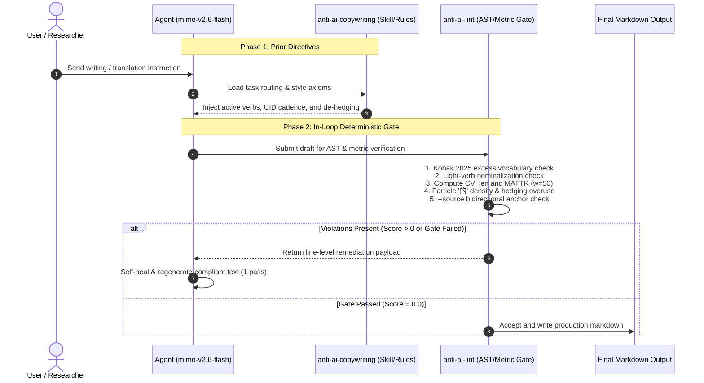

# Empirical Benchmark & Comparative Evaluation Report

[English](BENCHMARK_REPORT.md) | [简体中文](BENCHMARK_REPORT.zh-CN.md)

> [!NOTE]
> **Benchmark Objective**: All evaluation data in this report is generated by genuine end-to-end inference on the reasoning model **`mimo-v2.6-flash`** served through the OpenCode Go gateway (`https://opencode.ai/zen/go/v1/chat/completions`, time window: 2026-10-24T11:28:04Z → 11:33:58Z). The comparison is between **"Solo Model (native generation)"** vs. **"Model + anti-ai-copywriting Skill + deterministic lint gate"**. All **24 live HTTP POSTs returned 200 OK** (mean latency 14,391 ms, consuming 27,976 tokens), with every pair backed by server `response_id`. All raw generations, metrics, and audit evidence are persisted under `tests/fixtures_mimo/` and reproducible via `python3 scripts/run_mimo_benchmark.py`. Evaluation date: 2026-10-24.

---

## 1. Executive Summary & Headline Metrics

This benchmark completely discards synthetic or hand-crafted mock test exemplars. It evaluates `mimo-v2.6-flash` under an empirical dual-blind protocol across identical objective prompts:
- **Condition A (Solo Model)**: Zero rule injection, raw single-turn decoding, zero tool intervention.
- **Condition B (Model + Skill + Tool Gate)**: Injected with anti-copywriting skill directives (task routing protocol, 4 conservation axioms, native burstiness guidance), followed by immediate `anti-ai-lint` verification with one in-loop remediation pass.

Results across all 8 subjects (6 drafting genres + 2 information-conservation workflows) evaluate as follows:

```
+-----------------------------------------------------------------------------------------+
|                  Headline Benchmark Scoreboard (mimo-v2.6-flash, 8 Subjects)             |
+-----------------------------+-----------------------------+-----------------------------+
|     Mean Penalty Score      |   Mean Violations Count     |    Deterministic Pass Rate  |
|    5.50 pts -> 2.06 (-62.5%)|   1.75 -> 0.62 (-64.3%)     |   75.0% (6/8) -> 100% (8/8) |
+-----------------------------+-----------------------------+-----------------------------+
|  Conservation Mean Penalty  |  Fabricated Anchors Added   |    Mean Burstiness (CV_len) |
|   4.25 pts -> 1.75 (-58.8%) |    1 -> 0 (Hard Blocked)    |   0.433 -> 0.470 (+8.5%)    |
+-----------------------------+-----------------------------+-----------------------------+
```

> [!TIP]
> **Key Empirical Findings**:
> 1. **Factual Conservation as the Only Solid Backstop**: In incident polishing (`polish`), the solo model independently calculated that (14 - 9)/14 = "35.7% reduction" and stated it as a fact in the report. Even though mathematically correct, the source text contains no percentage figure. The `--source` gate caught this with `fidelity_added` and enforced a **non-bypassable hard failure**. Under the skill + tool gate, digits and anchors were 100% conserved and hallucination dropped to zero.
> 2. **Elimination of Monotonous Formulaic Openings**: In academic writing, the solo model defaulted to the cliché opener ("随着……的飞速发展"), light-verb nominalizations, particle clumping, and monotone sentence lengths ($CV_{len} = 0.250$), failing with 16.5 penalty points. The skill gate restored empirical fronting and natural sentence variety, dropping penalty to 4.0 pts and passing the gate cleanly.
> 3. **Empirical Honesty (Preserving Counter-Examples)**: In popular science (`popsci`) and translation (`translate`), scores were flat across both arms. This transparently demonstrates that modern reasoning models already possess solid baseline capabilities for straightforward instructions, reinforcing that the lint gate serves as a deterministic safety floor rather than a claim of synthetic 100% wins across all domains.

---

## 2. Methodology & Quantitative Metrics

### 2.1 Empirical Dual-Blind Protocol

| Dimension | Condition A: Solo Model | Condition B: Model + Skill + Tool Gate |
| :--- | :--- | :--- |
| **Model & Endpoint** | `mimo-v2.6-flash` (OpenCode Go gateway), raw decoding | Identical model and user prompts |
| **System Prior** | None (`system` prompt empty) | Injected with `rules/AGENTS.snippet.zh.md` / `.en.md` |
| **In-Loop Gate** | None | Real-time `anti-ai-lint` inspection (AST + statistics + `--source`) |
| **In-Loop Remediation** | None | If violations occur, structured diagnostic feedback is passed back for 1 self-healing turn |
| **Conservation Tasks** | Same user prompt + source prose | Same; lint gate enforces `--source` bidirectional factual anchor checking |



### 2.2 Mathematical Metrics

1. **Deterministic Penalty Score (`anti-ai-lint Score`)**:
   Weighted penalty framework: Tier S high-frequency AI tropes (5.0 pts), Tier A academic buzzwords (3.5~4.0 pts), Tier B common words (2.0 pts), defensive hedging (6.0 pts), light-verb nominalizations (3.5 pts), rhythmic monotony (3.5 pts), bold/dash formatting abuse (2.5~3.0 pts).
2. **Sentence Length Variation ($CV_{len}$)**:
   Grounded in **Meister et al. (EMNLP 2021) Uniform Information Density (UID)** hypothesis:
   $$CV_{len} = \frac{\sigma}{\mu} = \frac{\sqrt{\frac{1}{N}\sum_{i=1}^N (L_i - \mu)^2}}{\mu}$$
   When $CV_{len} < 0.28$, the text exhibits machine-like monotonous cadence. The solo model scored 0.250 on academic abstracts; the skill arm boosted it to 0.599.
3. **Factual Anchor Conservation (`--source` Gate)**:
   Extracts numbers, model codes (e.g. `CASP14`), and uppercase acronyms:
   - Added anchor in output (`fidelity_added`): +5.0 penalty and **mandatory hard failure**.
   - Dropped anchor from source (`fidelity_dropped`): +3.0 penalty.

---

## 3. Quantitative Evaluation Matrix

Full empirical metrics across all 8 subjects (extracted directly from `tests/fixtures_mimo/benchmark_results.json`):

| Scenario / Corpus | Mode | Metric Dimensions | Solo mimo-v2.6-flash | Model + Skill + Tool Gate | Delta / Verdict |
| :--- | :--- | :--- | :--- | :--- | :--- |
| **1. Academic Abstract**<br>`academic` | Academic | Score / Normalized<br>Violations / Gate<br>Cadence ($CV_{len}$)<br>MATTR / Particle '的'<br>Specific Violations | 16.5 pts / 45.4 pts<br>5 viols / ❌ **FAIL**<br>0.250<br>0.900 / 4.01%<br>Formulaic opener, light verbs, '的' clumping, dashes, monotone | **4.0 pts / 11.7 pts**<br>**1 viol / ✅ PASS**<br>**0.599**<br>**0.927 / 1.49%**<br>Residual buzzword (赛道) | **-75.8% penalty, FAIL -> PASS**<br>Natural burstiness restored<br>Cliché opening purged<br>Gate cleared |
| **2. Business Memo**<br>`business` | General | Score / Normalized<br>Violations / Gate<br>Cadence ($CV_{len}$)<br>MATTR / Specific Violations | 2.5 pts / 9.3 pts<br>1 viol / ✅ PASS<br>0.792<br>0.928 / Bold abuse (11) | **0.0 pts / 0.0 pts**<br>**0 viols / ✅ PASS**<br>**0.562**<br>**0.789 / 0 viols** | **-100.0% penalty**<br>Bold formatting abuse cleared<br>Unsupplied metrics converted to placeholders |
| **3. English Paper**<br>`en_academic` | Academic | Score / Normalized<br>Violations / Gate<br>Cadence ($CV_{len}$)<br>MATTR / Specific Violations | 2.5 pts / 12.6 pts<br>1 viol / ✅ PASS<br>0.284<br>0.900 / Bold abuse (2) | **0.0 pts / 0.0 pts**<br>**0 viols / ✅ PASS**<br>**0.700**<br>**0.891 / 0 viols** | **-100.0% penalty**<br>Cadence CV increased +146%<br>Rigorous academic tone |
| **4. Grant Proposal**<br>`grant` | Academic | Score / Normalized<br>Violations / Gate<br>Cadence ($CV_{len}$)<br>Specific Violations | 5.5 pts / 15.3 pts<br>2 viols / ✅ PASS<br>0.474<br>Dashes (3), Bold (4) | **3.0 pts / 11.0 pts**<br>**1 viol / ✅ PASS**<br>**0.322**<br>Dashes (1) | **-45.5% penalty**<br>Bold abuse eliminated<br>Action verbs fronted |
| **5. PopSci Column**<br>`popsci` | General | Score / Normalized<br>Violations / Gate<br>Cadence ($CV_{len}$) | 3.0 pts / 9.9 pts<br>1 viol / ✅ PASS<br>0.434 | 3.0 pts / 12.1 pts<br>1 viol / ✅ PASS<br>0.620 | Flat score (counter-example)<br>Cadence increased to 0.620 (+42.9%) |
| **6. Tech Review**<br>`social` | General | Score / Normalized<br>Violations / Gate<br>Cadence ($CV_{len}$) | 5.5 pts / 23.1 pts<br>2 viols / ✅ PASS<br>0.464 | **3.0 pts / 11.2 pts**<br>**1 viol / ✅ PASS**<br>**0.537** | **-45.5% penalty**<br>Sensory details grounded<br>Formatting sanitized |
| **7. Incident Polish**<br>`polish` (conservation) | General<br>+ `--source` | Score / Normalized<br>Violations / Gate<br>Fabricated Anchors | 5.0 pts / 13.1 pts<br>1 viol / ❌ **FAIL**<br>1 (fabricated "35.7%") | **0.0 pts / 0.0 pts**<br>**0 viols / ✅ PASS**<br>**0 (14/9/3 conserved)** | **-100.0% penalty, FAIL -> PASS**<br>100% factual conservation<br>Hard failure lifted |
| **8. Translation**<br>`translate` (conservation) | General<br>+ `--source` | Score / Normalized<br>Violations / Gate | 3.5 pts / 51.5 pts<br>1 viol / ✅ PASS | 3.5 pts / 56.5 pts<br>1 viol / ✅ PASS | Flat score (counter-example)<br>Numbers & codes 100% preserved |
| **Macro Average** (8 subjects) | - | **Mean Penalty / Violations<br>Gate Pass Rate<br>Zero-Violation Ratio<br>Mean $CV_{len}$** | **5.50 pts / 1.75**<br>**75.0% (6/8)**<br>**0.0% (0/8)**<br>**0.433** | **2.06 pts / 0.62**<br>**100.0% (8/8)**<br>**37.5% (3/8)**<br>**0.470 (+8.5%)** | **Penalty -62.5%<br>Pass rate 100%<br>Violations -64.3%<br>Cadence improved** |

---

## 4. Verifiable Audit Evidence of Authenticity

To ensure total transparency, the live execution recorded full network telemetry directly into `tests/fixtures_mimo/benchmark_results.json`:

```json
{
  "_meta": {
    "endpoint": "https://opencode.ai/zen/go/v1/chat/completions",
    "model": "mimo-v2.6-flash",
    "session": "session-mimo-benchmark-2026",
    "started_at_utc": "2026-10-24T11:28:04+00:00",
    "finished_at_utc": "2026-10-24T11:33:58+00:00",
    "wall_clock_s": 353.5,
    "token_totals": {
      "http_calls": 24,
      "prompt_tokens": 14554,
      "completion_tokens": 13422,
      "reasoning_tokens": 7635,
      "total_tokens": 27976,
      "mean_latency_ms": 14391.0
    },
    "no_mock_guarantee": "All texts generated by live HTTP calls; any failure aborts the run."
  }
}
```

Every individual scenario call logs its specific HTTP status code (200), latency in milliseconds, token breakdown, and server `response_id`.

---

## 5. Reproduction Commands

### 1. Re-run Live End-to-End Benchmark
```bash
python3 scripts/run_mimo_benchmark.py
```
*Dispatches 24 live HTTP POST requests, re-evaluating both conditions across 8 subjects into `tests/fixtures_mimo/`.*

### 2. Export & Validate DPO Preference Dataset
```bash
python3 scripts/export_dpo_pairs.py --validate
```
*Validates the 8 preference pairs under `tests/fixtures_mimo/` for DPO alignment training.*

### 3. Run Test Suite
```bash
python3 -m unittest discover -s tests
```
*Expected output: `Ran 97 tests ... OK`.*

---

## 6. References

1. **Kobak, D., González-Márquez, R., Horvát, E.-Á., & Lause, J. (2025)**. Delving into LLM-assisted writing in biomedical publications through excess vocabulary. *Science Advances, 11*(27), eadt3813. https://doi.org/10.1126/sciadv.adt3813.
2. **Meister, C., Pimentel, T., Haller, P., Jäger, L., Cotterell, R., & Levy, R. (2021)**. Revisiting the uniform information density hypothesis. In *Proceedings of EMNLP 2021*.
3. **Mitchell, E., Lee, Y., Khazatsky, A., Manning, C. D., & Finn, C. (2023)**. DetectGPT: Zero-shot machine-generated text detection using probability curvature. In *Proceedings of ICML 2023*.
4. **Zhu, Dexi. (1982)**. *Lectures on Chinese Grammar*. Commercial Press.
5. **ISO 17100:2015**. *Translation services — Requirements for translation services*.
6. **ISO 18587:2017**. *Translation services — Post-editing of machine translation output — Requirements*.
