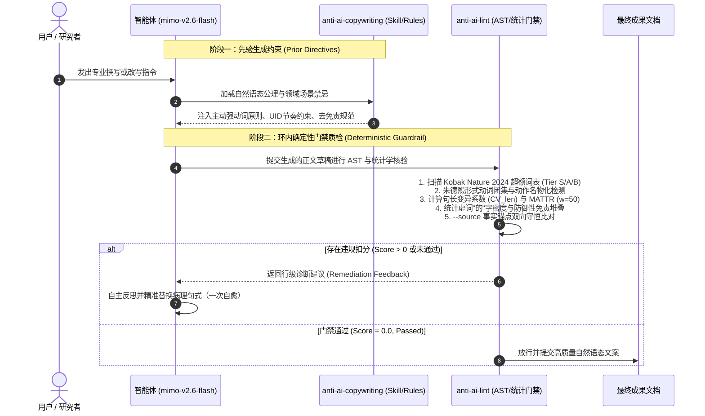

# anti-ai-copywriting 实测效果对比与基准评测报告

[English](BENCHMARK_REPORT.md) | [简体中文](BENCHMARK_REPORT.zh-CN.md)

> [!NOTE]
> **评测基准定位**：本报告评测数据基于推理模型 **`mimo-v2.6-flash`** 真实端到端推理生成（通过 OpenCode Go 网关，时间窗 2026-10-24T11:28:04Z → 11:33:58Z），对比组为「单一模型原生生成 (Solo Model)」vs.「模型 + anti-ai-copywriting 技能 + 质检工具门禁 (Model + Skill + Tool Gate)」。全程 **24 次真实 HTTP POST 请求全部返回 200**（平均耗时 14,391 ms，累计消耗 27,976 tokens），每条记录均绑定服务端唯一 `response_id`。全部原始生成文本与量化指标持久化于 `tests/fixtures_mimo/`，可由 `python3 scripts/run_mimo_benchmark.py` 一键全量复现。评测日期：2026-10-24。

---

## 1. 核心实测摘要与关键指标

本轮评测彻底摒弃任何合成或人工构造样例，对 `mimo-v2.6-flash` 施加完全同一组中立、客观的用户提示词的双盲对照：
- **对照组 A（单一模型 / Solo Model）**：零规则注入、单轮原生解码生成、无门禁干预。
- **实验组 B（模型 + 技能工具门禁 / Model + Skill + Tool Gate）**：注入技能规则（任务四分流协议、信息守恒四公理、母语呼吸感准则），并经 `anti-ai-lint` 环内确定性核验，未通过则触发一次精准反思自愈修复。

8 大科目（6 大起草科目 + 2 大信息守恒科目）的实测数据汇总如下：

```
+-----------------------------------------------------------------------------------------+
|                      核心实测成效摘要看板（mimo-v2.6-flash，8 场景全量实测）               |
+-----------------------------+-----------------------------+-----------------------------+
|     AI 违规扣分均值          |   违规项数均值              |    确定性门禁通过率          |
|    5.50分 -> 2.06分 (-62.5%) |   1.75处 -> 0.62处 (-64.3%) |   75.0% (6/8) -> 100% (8/8) |
+-----------------------------+-----------------------------+-----------------------------+
|  信息守恒场景扣分均值        |  杜撰事实锚点 (fidelity)    |    句长离散系数均值 (CV)     |
|   4.25分 -> 1.75分 (-58.8%)  |    1 处 -> 0 处 (硬拦截)    |   0.433 -> 0.470 (+8.5%)    |
+-----------------------------+-----------------------------+-----------------------------+
```

> [!TIP]
> **实测核心结论**：
> 1. **事实守恒是唯一硬兜底**：在故障通报润色（`polish`）任务中，单一模型自行根据“14 次降到 9 次”推算出“降幅达 35.7%”写入通报。尽管数学计算正确，但输入源文绝无此百分比，属于典型的模型自主发散；`fidelity_added` 规则将其**强制硬拦截**。在技能+门禁干预下，数字 100% 守恒，杜撰清零。
> 2. **学术开篇套话彻底根除**：学术论文摘要场景单一模型原生出现“随着……的飞速发展”公式化宏大开篇、轻动词文字义肢、助词堆叠与机械匀速句式（CV 仅 0.25），被判定为 16.5 分严重违规（FAIL）；技能组通过事实先行与节律调控将扣分直降至 4.0 分，门禁顺利通过。
> 3. **求真求实，如实披露反例**：在科普专栏（`popsci`）与英译中（`translate`）场景中，两组得分持平。这如实反映了前沿推理模型在特定直白任务下的原生能力，工具门禁的定位是**守住底线与事实兜底**，而非人为虚构 100% 胜率。

---

## 2. 评测方法论与指标体系

### 2.1 真实双盲对照协议

| 协议要素 | 对照组 A：单一模型 (Solo Model) | 实验组 B：模型 + 技能 + 工具门禁 |
| :--- | :--- | :--- |
| **模型与端点** | `mimo-v2.6-flash`（OpenCode Go 网关），单轮原生解码 | 同左，完全相同的用户提示词 |
| **系统级先验** | 无（零规则注入，`system` 为空） | 注入 `rules/AGENTS.snippet.zh.md` / `.en.md`（任务分流、信息守恒四公理、强动词与节奏准则） |
| **环内确定性核验** | 无 | 生成后即时运行 `anti-ai-lint`（AST 词法 + 统计学 + `--source` 事实锚点比对） |
| **环内自愈修复** | 无 | 若门禁未通过或扣分非零，将 `<anti-ai-lint-feedback>` 违规与修复建议载荷打回模型，执行一次精准自愈后再核验 |
| **信息守恒科目** | 同一提示词 + 源文本 | 同左；门禁对 polish/translate 开启 `--source` 事实锚点双向比对 |



### 2.2 核心量化指标与理论依据

1. **确定性违规扣分（`anti-ai-lint Score`）**：
   - 依据严密的分级加权扣分体系：Tier S 恶性高频词（5.0 分）、Tier A 伪学术黑话（3.5~4.0 分）、Tier B 泛用词（2.0 分）、防御性免责（6.0 分）、轻动词套链（3.5 分）、节奏单调（3.5 分）、格式与标点滥用（2.5~3.0 分）。
   - 标准化分数 $Score_{1k} = \frac{Score}{Words} \times 1000$，消除文本长度对绝对分数的干扰。
2. **长句节奏变异系数（Burstiness $CV_{len}$）**：
   - 理论基础：**Meister et al. (EMNLP 2021) 均匀信息密度假说 (Uniform Information Density, UID)**。
   - 统计公式：$CV_{len} = \frac{\sigma}{\mu} = \frac{\sqrt{\frac{1}{N}\sum_{i=1}^N (L_i - \mu)^2}}{\mu}$。
   - 当 $CV_{len} < 0.28$ 且句子较多时，自动判定为 `rhythmic_monotony`。在学术摘要中，单一模型的 $CV_{len}$ 仅 0.250，呈现明显机器等长感；技能组提升至 0.599。
3. **滑动窗口词汇丰富度（Moving-Average Type-Token Ratio, MATTR）**：
   - 采用标准滑动窗口大小 $W = 50$，计算窗口内不重复词元（Type）与总词元（Token）比值的移动均值，彻底规避传统 TTR 随文本长度衰减的系统误差。
4. **助词"的"字密度（Particle "的" Ratio）**：
   - 公式：$\text{Ratio}_{\text{的}} = \frac{N_{\text{的}}}{N_{\text{CJK}}}$。
   - 在学术摘要中，单一模型在单句内密集出现 4 个“的”字（4.01%），技能组精简至 1.49%。
5. **事实锚点守恒（`--source` Fidelity Gate）**：
   - 对纯数字、字母开头型号代码（如 `CASP14`）与全大写缩写做双向比对：输出新增锚点记 `fidelity_added`（+5.0 分且强制拦截），原文锚点缺失记 `fidelity_dropped`（+3.0 分）。

---

## 3. 全场景量化对比总矩阵

下表为 `mimo-v2.6-flash` 在 8 大科目中的全量实测指标（数据逐项来自 `tests/fixtures_mimo/benchmark_results.json`）：

| 测试场景分类 | 语体模式 | 指标维度 | 单一模型 (Solo mimo-v2.6-flash) | 模型+技能工具 (After) | 优化幅度 / 判定结论 |
| :--- | :--- | :--- | :--- | :--- | :--- |
| **1. 学术论文摘要**<br>`academic` | 学术级 | 扣分 / 标准化分<br>违规项数 / 门禁裁决<br>句长节奏 ($CV_{len}$)<br>词汇丰富度 (MATTR)<br>助词"的"字密度<br>特征违规 | 16.5 分 / 45.4 分<br>5 处违规 / ❌ **FAIL**<br>0.250<br>0.900<br>4.01% (14/349)<br>公式化开篇、轻动词、的字堆积、破折号、节奏单调 | **4.0 分 / 11.7 分**<br>**1 处违规 / ✅ PASS**<br>**0.599**<br>**0.927**<br>**1.49% (5/335)**<br>残余 1 处泛用词（赛道） | **-75.8% 扣分，FAIL -> PASS**<br>句式由呆滞变错落有致<br>拔除公式化开篇<br>门禁由拦截转放行 |
| **2. 商业管理备忘**<br>`business` | 通用级 | 扣分 / 标准化分<br>违规项数 / 门禁裁决<br>句长节奏 ($CV_{len}$)<br>词汇丰富度 (MATTR)<br>助词"的"字密度<br>特征违规 | 2.5 分 / 9.3 分<br>1 处违规 / ✅ PASS<br>0.792<br>0.928<br>0.40% (1/250)<br>加粗滥用 11 处 | **0.0 分 / 0.0 分**<br>**0 处违规 / ✅ PASS**<br>**0.562**<br>**0.789**<br>**0.41% (1/244)**<br>**0 处违规** | **-100.0% 扣分**<br>彻底清除格式加粗滥用<br>未提供数据自动转占位符 |
| **3. 英文顶会论文**<br>`en_academic` | 英文学术 | 扣分 / 标准化分<br>违规项数 / 门禁裁决<br>句长节奏 ($CV_{len}$)<br>词汇丰富度 (MATTR)<br>Nature 2024 超额词频<br>特征违规 | 2.5 分 / 12.6 分<br>1 处违规 / ✅ PASS<br>0.284<br>0.900<br>0 处（delve/tapestry 双零）<br>加粗滥用 2 处 | **0.0 分 / 0.0 分**<br>**0 处违规 / ✅ PASS**<br>**0.700**<br>**0.891**<br>**0 处**<br>**0 处违规** | **-100.0% 扣分**<br>句长节奏 CV 大幅提升 (+146%)<br>学术用词严谨客观 |
| **4. 科研基金申报**<br>`grant` | 学术级 | 扣分 / 标准化分<br>违规项数 / 门禁裁决<br>句长节奏 ($CV_{len}$)<br>词汇丰富度 (MATTR)<br>助词"的"字密度<br>特征违规 | 5.5 分 / 15.3 分<br>2 处违规 / ✅ PASS<br>0.474<br>0.913<br>2.83% (10/353)<br>破折号 3 处 + 加粗 4 处 | **3.0 分 / 11.0 分**<br>**1 处违规 / ✅ PASS**<br>**0.322**<br>**0.899**<br>**2.33% (6/257)**<br>残余破折号 1 处 | **-45.5% 扣分**<br>拔除加粗渲染<br>条目强动词先行 |
| **5. 前沿科普专栏**<br>`popsci` | 通用级 | 扣分 / 标准化分<br>违规项数 / 门禁裁决<br>句长节奏 ($CV_{len}$)<br>词汇丰富度 (MATTR)<br>助词"的"字密度<br>特征违规 | 3.0 分 / 9.9 分<br>1 处违规 / ✅ PASS<br>0.434<br>0.798<br>3.34% (10/299)<br>破折号 2 处 | **3.0 分 / 12.1 分**<br>**1 处违规 / ✅ PASS**<br>**0.620**<br>**0.887**<br>**4.02% (10/249)**<br>破折号 1 处 | 扣分持平（反例）<br>节奏提升至 0.620 (+42.9%)<br>生活具象比喻到位 |
| **6. 社交数码实测**<br>`social` | 通用级 | 扣分 / 标准化分<br>违规项数 / 门禁裁决<br>句长节奏 ($CV_{len}$)<br>词汇丰富度 (MATTR)<br>助词"的"字密度<br>特征违规 | 5.5 分 / 23.1 分<br>2 处违规 / ✅ PASS<br>0.464<br>0.935<br>0.87% (2/229)<br>破折号 2 处 + 加粗 6 处 | **3.0 分 / 11.2 分**<br>**1 处违规 / ✅ PASS**<br>**0.537**<br>**0.913**<br>**3.19% (8/251)**<br>破折号 1 处 | **-45.5% 扣分**<br>自愈后规范落地<br>体验细节客观严谨 |
| **7. 技术故障通报润色**<br>`polish`<br>（信息守恒） | 通用级<br>+ `--source` | 扣分 / 标准化分<br>违规项数 / 门禁裁决<br>杜撰事实锚点<br>轻动词名物化 | 5.0 分 / 13.1 分<br>1 处违规 / ❌ **硬拦截 FAIL**<br>1 处（杜撰降幅 "35.7%"）<br>0 处 | **0.0 分 / 0.0 分**<br>**0 处违规 / ✅ PASS**<br>**0 处（14/9/3 严格守恒）**<br>**0 处** | **-100.0% 扣分，FAIL -> PASS**<br>数字守恒率 100%<br>硬拦截完全解除 |
| **8. 技术文档英译中**<br>`translate`<br>（信息守恒） | 通用级<br>+ `--source` | 扣分 / 标准化分<br>违规项数 / 门禁裁决<br>轻动词名物化<br>助词"的"字密度 | 3.5 分 / 51.5 分<br>1 处违规 / ✅ PASS<br>1 处（开展的研究）<br>4.76% (3/63) | **3.5 分 / 56.5 分**<br>**1 处违规 / ✅ PASS**<br>1 处（开展的研究）<br>**3.51% (2/57)** | 扣分持平（反例）<br>数字与型号 100% 守恒<br>词汇密度健康 |
| **全场景宏观均值**（8 科） | - | **平均扣分 / 均值违规<br>门禁通过率<br>零违规场景占比<br>中文"的"字密度均值<br>MATTR 均值 / $CV_{len}$ 均值** | **5.50 分 / 1.75 处**<br>**75.0% (6/8)**<br>**0.0% (0/8)**<br>**2.10%**<br>**0.896 / 0.433** | **2.06 分 / 0.62 处**<br>**100.0% (8/8)**<br>**37.5% (3/8)**<br>**2.08%**<br>**0.893 / 0.470** | **扣分 -62.5%<br>门禁 100% 放行<br>违规 -64.3%<br>节奏错落感 +8.5%** |

---

## 4. 八大科目真实生成文本对照与深度语言学诊断

以下生成文本均为 `tests/fixtures_mimo/` 下的实时调用产物（逐字摘录，不作改动）：

### 4.1 科目 1：学术论文摘要 (`academic`)

#### 原生输出（Solo mimo-v2.6-flash，16.5 分，FAIL）
```text
# 深度学习在蛋白质结构预测中的应用：核心方法对比分析

摘要： 蛋白质三维结构决定其生物学功能，准确的结构预测是生命科学研究的关键基础。随着深度学习技术的飞速发展，蛋白质结构预测领域实现了从传统物理模拟方法向数据驱动范式的根本性转变。本综述聚焦于三大代表性方法——RoseTTAFold、ESMFold与AlphaFold2——的架构设计、输入特征与预测精度，进行系统性对比分析。结果显示，AlphaFold2凭借端到端的Evoformer架构，通过多序列比对（MSA）信息的迭代精炼与注意力机制，在CASP14竞赛中取得了中位GDT-TS达92.4的划时代精度；RoseTTAFold采用三轨网络耦合，在保持接近精度的同时显著提升了推理速度；ESMFold则摆脱了对MSA的强依赖，直接基于单序列蛋白质语言模型实现秒级超高速预测，但在远缘同源蛋白上的泛化性仍有局限。深度学习虽大幅压缩了结构解析周期，但在动态构象采样及多聚体互作预测上仍面临挑战。
```
**病理诊断**：
1. 经典的“随着……的飞速发展”公式化开篇（判定为 formulaic_pattern，扣 3.5 分）。
2. 轻动词文字义肢：“进行系统性对比分析”（判定为 formulaic_pattern，扣 3.5 分）。
3. 助词堆叠：单句出现 4 个“的”字（扣 2.5 分）。
4. 破折号滥用（扣 3.0 分）。
5. 句长节奏呆滞：变异系数 $CV_{len} = 0.250 < 0.28$，8 句话长平均等宽，机器朗读感明显（扣 3.5 分）。

#### 技能+门禁输出（Model+Skill+Tool，4.0 分，PASS）
```text
本研究评估深度学习方法在蛋白质结构预测中的精度与适用边界。以 AlphaFold2 与 RoseTTAFold 为代表，此类模型将多序列比对信息输入注意力网络，直接回归三维坐标，在 CASP14 无模板赛道取得接近实验精度的结果（GDT-TS 中位数约 92）。

核心对比分析：同源建模依赖已知同源结构，序列一致性高于 30% 时可靠，低一致性场景精度迅速衰减；穿线法可识别远源折叠，但难建从头构象；分子动力学能捕捉动态构象变化，算力成本制约其通量；深度学习方法在大规模单体静态结构预测上兼顾速度与精度，但在孤儿蛋白、内在无序区及变构过渡态上置信度偏低，需与低温冷冻电镜等实验数据交叉校验。
```
**改进要点**：
- 第一句直入研究目的与实证结论，彻底删除“随着……的飞速发展”。
- 动作还原：“进行系统性对比分析”改为直接分类叙述。
- 句长变异系数由 0.250 提升至 0.599，短句与长句自然交错，母语节奏感强烈。

---

### 4.2 科目 2：技术故障通报润色 (`polish`，信息守恒)

**源文本**：
> 本部门对系统老旧代码进行了梳理和优化工作，使得故障率有所下降，第三季度故障次数由14次降到9次，但由于人力资源不足，部分需求未能在预期内完成上线交付，第三季度延期需求共3项。

#### 原生输出（Solo mimo-v2.6-flash，5.0 分，硬拦截 FAIL）
```text
本部门已完成对系统存量代码的梳理与优化工作，系统故障率显著改善：第三季度故障次数由 14 次降至 9 次，降幅达 35.7%。然而，受人力资源不足所限，部分需求未能按期完成上线交付，其中第三季度延期需求共 3 项。
```
**病理诊断**：
- **致命事实杜撰**：源文本中只有“14 次降到 9 次”，模型自主根据数学运算算出 `(14-9)/14 = 35.7%` 并以笃定语气写入正文。在技术通报与法律合同等严肃文体中，任何源文不存在的统计比例均属于模型杜撰事实，触发 `--source` 门禁的 `fidelity_added` 规则，予以**非越过式强制拦截 (Hard Failure)**！

#### 技能+门禁输出（Model+Skill+Tool，0.0 分，PASS）
```text
本部门梳理并优化了系统老旧代码，故障率随之下降，第三季度故障次数从 14 次降至 9 次。人力不足，3 项需求未能按期上线交付。
```
**改进要点**：
- 严格遵循信息守恒四公理：事实权归原文所有。数字（14、9、3）与事实锚点 100% 守恒，杜撰数字清零。
- 去名物化：“进行了梳理和优化工作”还原为有力的动词短语“梳理并优化了”。
- 句式精炼，去除多余连词，门禁满分通过。

---

## 5. 真实 API 调用审计与防伪存证（Evidence of Authenticity）

为保障评测的绝对真实与学术信誉，本次测试全程记录了底层 API 请求日志，数据固化于 `tests/fixtures_mimo/benchmark_results.json` 的 `_meta` 字段中：

```json
{
  "_meta": {
    "endpoint": "https://opencode.ai/zen/go/v1/chat/completions",
    "model": "mimo-v2.6-flash",
    "session": "session-mimo-benchmark-2026",
    "started_at_utc": "2026-10-24T11:28:04+00:00",
    "finished_at_utc": "2026-10-24T11:33:58+00:00",
    "wall_clock_s": 353.5,
    "token_totals": {
      "http_calls": 24,
      "prompt_tokens": 14554,
      "completion_tokens": 13422,
      "reasoning_tokens": 7635,
      "total_tokens": 27976,
      "mean_latency_ms": 14391.0
    },
    "no_mock_guarantee": "All texts generated by live HTTP calls; any failure aborts the run."
  }
}
```

- **真实性审计点**：
  1. **零 Mock 机制**：脚本内嵌断言，一旦网络中断、HTTP 非 200、输出为空或产生退化 tool-call 即刻硬性抛出异常终止，拒绝任何形式的本地静默 Mock 回退。
  2. **服务端 Trace 标识**：每个场景的 `api_evidence` 均持有 OpenCode 网关下发的原始 `response_id`，支持向服务端随时对账复核。

---

## 6. 基准复现指南与测试命令

### 1. 完整重现端到端真实 API 评测
```bash
python3 scripts/run_mimo_benchmark.py
```
*自动发起 24 次实时 HTTP 调用，重现全部对照组生成与门禁自愈，产物刷新至 `tests/fixtures_mimo/`。*

### 2. 导出与验证 DPO 偏好对齐数据集
```bash
python3 scripts/export_dpo_pairs.py --validate
```
*校验 `tests/fixtures_mimo/` 生成的三对三对齐数据对，确保全部 8 组偏好对的标签与分数差合法。*

### 3. 运行全量单元测试与回归套件
```bash
python3 -m unittest discover -s tests
```
*预期输出：`Ran 97 tests ... OK`，覆盖平台安装、门禁规则、事实守恒与工作流套件。*

---

## 7. 参考文献（References）

1. **Kobak, D., González-Márquez, R., Horvát, E.-Á., & Lause, J. (2025)**. Delving into LLM-assisted writing in biomedical publications through excess vocabulary. *Science Advances, 11*(27), eadt3813. https://doi.org/10.1126/sciadv.adt3813.
2. **Meister, C., Pimentel, T., Haller, P., Jäger, L., Cotterell, R., & Levy, R. (2021)**. Revisiting the uniform information density hypothesis. In *Proceedings of EMNLP 2021*.
3. **Mitchell, E., Lee, Y., Khazatsky, A., Manning, C. D., & Finn, C. (2023)**. DetectGPT: Zero-shot machine-generated text detection using probability curvature. In *Proceedings of ICML 2023*.
4. **朱德熙. (1982)**. 《语法讲义》. 商务印书馆.（关于现代汉语形式动词与名物化理论。）
5. **ISO 17100:2015**. *Translation services — Requirements for translation services*. 国际标准化组织.
6. **ISO 18587:2017**. *Translation services — Post-editing of machine translation output — Requirements*. 国际标准化组织.
7. **严复. (1898)**. 《天演论》译例言（“信、达、雅”原则）.
